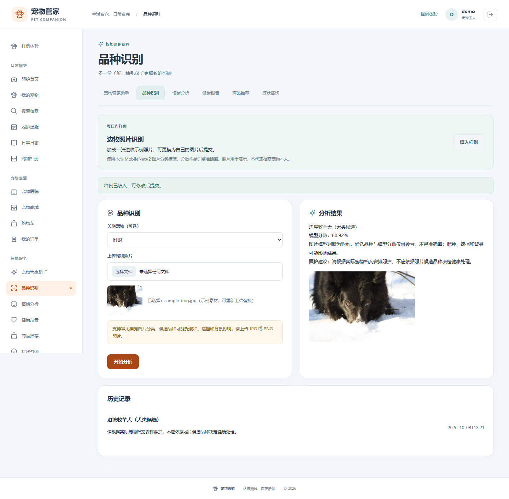
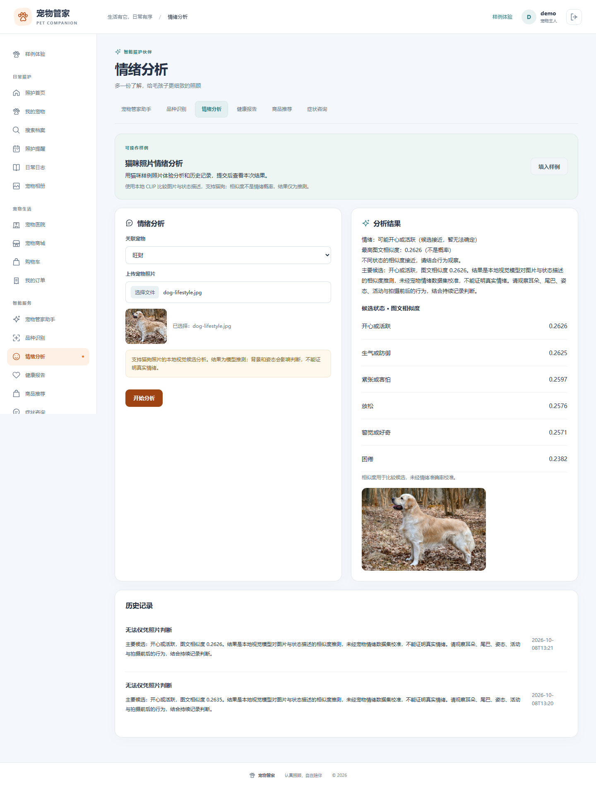

# 宠物图片识别修复记录（2026-10-08）

问题：用户上传边牧照片，却被识别为猫。原代码只在猫的毛色类别中选择结果，并固定输出 75%；情绪入口用亮度、颜色和边缘特征推断情绪，没有可靠的情绪模型。

修复：品种入口使用本地 MobileNetV2 / ImageNet ONNX 模型，依据像素推理猫狗与候选品种。未获得可靠的猫狗分类时返回无法确认。分数是模型输出，不是实测准确率。关联宠物资料和文件名不会决定识别结果。

情绪入口目前未具备真实情绪识别能力，返回 `observation_only`、`uncertain` 和空分数，显示无法仅凭照片判断，并提供行为观察提示。损坏图片在两个入口均返回 HTTP 400，不写入识别历史。

验证：公开边牧样例返回犬类、边境牧羊犬候选（60.92 分）；猫咪样例返回猫类；另一犬类样例返回犬类，但其品种候选仍可能有误，不能认为所有品种已准确识别。黑色空白图片返回无法确认。尚未获得用户原图，因此这些用例不能替代对用户原图的验证。

自动化：`src/test/java/com/petmgmt/ai/PetImageRecognitionTest.java`；页面验证：`scripts/verify-image-recognition.cjs`；响应记录：`docs/evidence/recognition-fix/verification.json`。

本记录反映修复后的实现；此前综合实验报告中的猫毛色规则及情绪特征规则描述属于修复前版本。

## 后续更新：本地猫狗情绪候选分析

情绪入口已改用本地 CLIP 图文相似度模型，支持猫、狗，输出六类候选状态及余弦相似度。上文 observation_only 为此前版本。模型结果属于未校准的视觉推测，不是真实情绪诊断。前两项相似度接近时显示不确定。自选图片新增预览；独立图片包的哈士奇 JPG 已完成上传、推理、结果与历史保存验证。最新截图：`evidence/recognition-fix/emotion-husky-local.png`。
