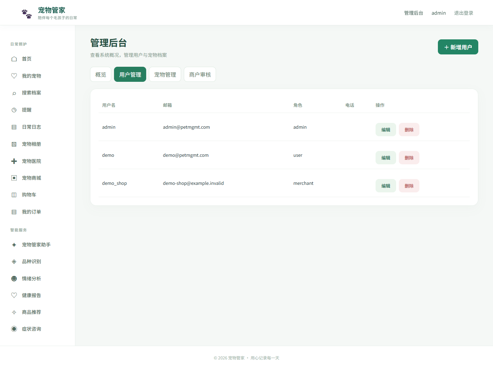
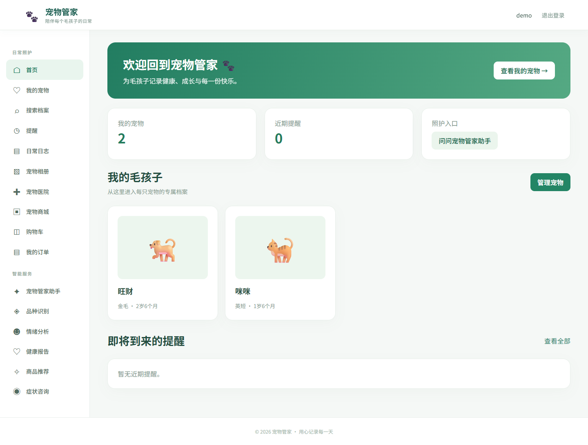
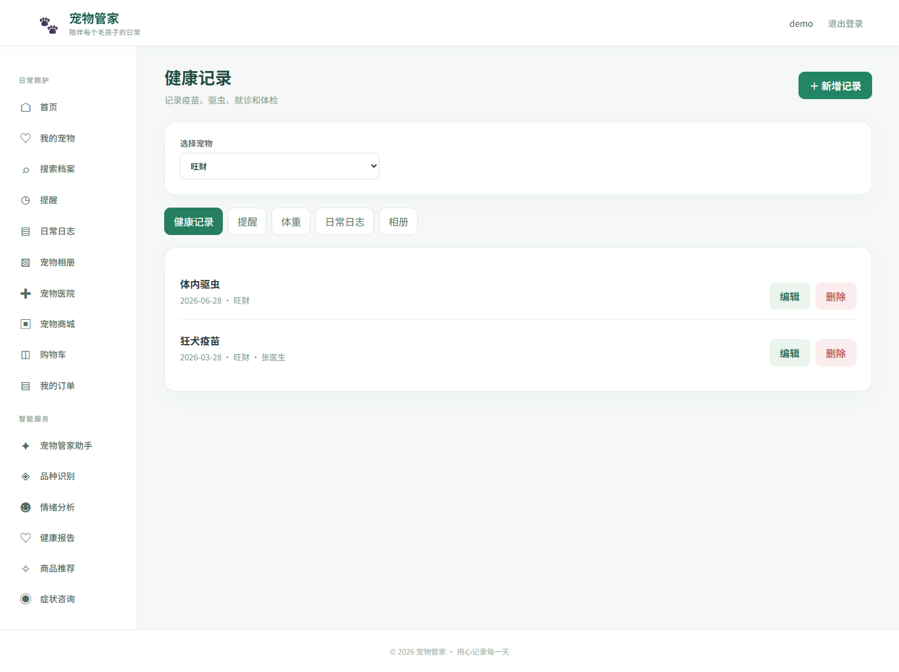
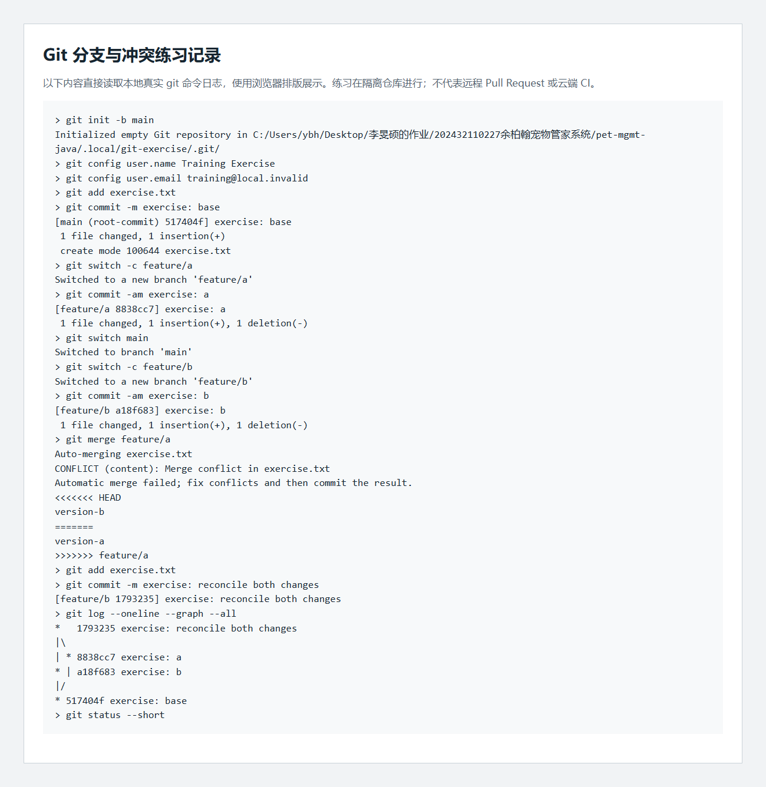
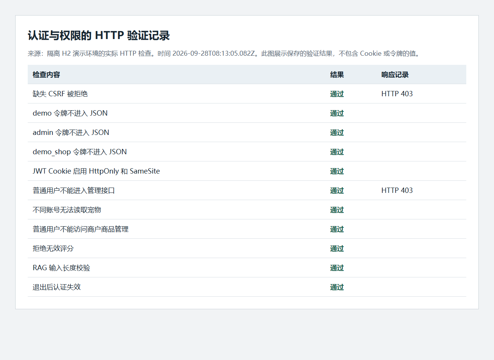
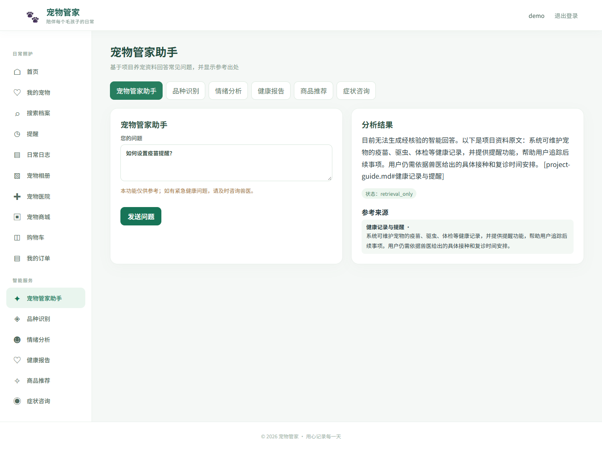

# 宠物管家系统个人技能实训综合报告

第二部分 个人技能实训

学号 202432110227　姓名 余柏翰

本报告将实验一至实验五合并为一份文档，记录宠物管家系统从原有 Java 项目到前后端分离实训项目的改造过程。业务仍围绕宠物档案、健康照护、医院、商城、商户和 AI 辅助服务；新增内容用于满足工程实践、安全、协作和大模型应用要求。

AI 在本次工作中用于理解代码、编写实现与测试、检查缺陷和整理文档。代码是否可用，以编译、自动测试、接口和浏览器验证为依据。报告不将 AI 输出等同于正确答案，也不替代学生对代码的理解与讲解。

## 项目内容与实现要求

| 原有业务 | 本次实现方式 |
| --- | --- |
| 注册登录、个人资料、用户管理 | Spring Security、BCrypt、Cookie JWT、MyBatis 用户 CRUD |
| 宠物档案、健康、提醒、体重、日志、相册 | 保留领域模型与业务关系，通过 Vue 调用 REST API |
| 宠物医院与评价 | 查询、地图展示及有边界校验的评价接口 |
| 商品、购物车、订单、商户、管理员 | 独立 Vue 页面、归属校验及库存和订单状态验证 |
| 品种、情绪、健康报告、推荐、咨询 | 保留已有入口与本地算法，新增基于项目资料的 RAG 助手 |

后端采用 Spring Boot 3.4.5，编译目标为 Java 17。用户管理采用 Entity/DTO、Mapper、Service、Controller 分层；其他业务继续使用 JPA，避免为更换持久层破坏已有业务关系。前端采用 Vue 3、Vue Router、Axios 与 Vite，可独立构建。

默认数据库配置为 MySQL；本次自动测试与浏览器演示使用隔离的 H2 内存数据库，不读取或清空现有 MySQL 数据。当前工作机使用 Java 21 执行 Maven，以 release 17 生成兼容字节码；云端 CI 配置使用 Java 17。实际 MySQL 迁移与云端运行不能由 H2 测试结果替代。

商户账单保留查询入口。原有支付模板没有连接真实支付服务，本次提供只读账单，不将模拟按钮描述为已完成的线上缴费。演示环境中的商品和医院均明确标为虚构数据。

## 实验一 搭建 Web 基础项目

### 目标与主要步骤

在保留宠物管家业务的基础上，整理 Maven 项目与数据源配置，完成用户表 CRUD，并通过内嵌容器运行后端。

1. 将 Maven 的 source、target、release 统一设置为 17，保留 Spring Boot Web、Validation、Security、MySQL 等依赖，增加 MyBatis 与 OpenAPI。
2. 在 application.yml 中使用环境变量读取数据库密码和 JWT 密钥。演示配置单独放入 application-demo.yml，仅连接内存数据库。
3. 使用已有 users 表。AdminUserRequest 校验请求字段，AdminUserMapper 使用参数绑定执行 SQL，AdminUserService 负责密码哈希、事务与角色关系，AdminUserController 负责 HTTP 响应。
4. 管理员调用 /api/admin/users 完成新增、列表、详情、更新和删除。重复用户名/邮箱返回冲突，存在关联业务的用户拒绝删除。
5. 执行 Maven 测试与打包，再运行 jar 验证服务启动。管理员页面展示真实接口数据。

```powershell
mvn.cmd -Dmaven.repo.local=.m2repo verify
java -jar target/pet-mgmt-java-1.0.0.jar --spring.profiles.active=demo
```

### 关键代码说明

MyBatis 使用 #{...} 绑定参数，避免将用户输入拼接成 SQL。创建用户时先计算 BCrypt 哈希，再将用户和角色关系放入同一事务；返回 DTO 不包含 passwordHash。

```java
@Transactional
public User create(AdminUserRequest request) {
    User user = copy(request, new User());
    user.setIsApproved(true);
    users.insert(user);
    roles.assign(user.getId(), user.getRole());
    return users.find(user.getId());
}
```

以上节选自 AdminUserService，省略了前置密码校验。Controller 与 Service 分开后，数据库异常能够先触发事务回滚，再转换为可理解的接口错误；不能在事务内部吞掉异常后仍声称写入成功。



### 验证与总结反思

自动验证检查用户新增、查询、修改、删除、重复数据和关联删除限制。浏览器验证管理员页面与真实接口联动。H2 能验证本次 CRUD 和权限链路，但无法证明所有 MySQL 方言和已有数据库迁移均正确；部署前需备份并检查迁移脚本。

本实验的重点是理解请求如何穿过各层，而非仅让脚手架启动。需要能够解释为什么密码不直接入库、为什么参数绑定不同于字符串拼接，以及事务何时回滚。

### AI 工具使用记录

工具：Codex。环节：盘点旧工程、生成分层实现与测试、检查事务边界。提示词要点：保留现有 users 表和业务数据，新增 MyBatis CRUD，密码 BCrypt，禁止返回密码或令牌。验证：编译和集成测试、管理员页面操作，并人工审查 SQL、DTO 与事务边界。学生仍需自行理解并讲解代码。

## 实验二 前后端分离与 RESTful API

### 目标与主要步骤

1. 建立 frontend 独立工程，使用 Vue 组件与路由替换原有页面交互，继续呈现宠物管家业务。
2. Axios 使用统一 /api 前缀、超时、凭据和错误提示；开发环境由 Vite 代理连接 8080 后端，部署环境可设置独立 API 地址。
3. 整理宠物、医院和商城的 JSON 接口，补充健康、提醒、体重、日志、相册等子资源接口，并校验宠物归属。
4. 后端配置 CORS 白名单；对携带 Cookie 的跨域请求不使用任意来源通配符。前后端分别构建，再通过真实浏览器联调。
5. 通过 OpenAPI 查看接口结构，人工核对请求字段、返回值和错误边界。

```javascript
const api = axios.create({
  baseURL: import.meta.env.VITE_API_BASE_URL || '/api',
  withCredentials: true
})
```

该代码展示统一客户端的核心配置，实际实现还包含超时、CSRF 请求头和错误处理。withCredentials 允许浏览器按规则携带 Cookie，不意味着 JavaScript 可以读取 HttpOnly JWT。





### 验证与总结反思

验证涵盖页面构建、表单提交、接口错误、宠物档案、照护记录、购物车与订单等流程。宠物图片、用户数据和业务规则不应因为视图技术迁移而丢失。

联调中需要区分三类问题：请求没有到达后端、后端拒绝权限或字段、前端没有正确展示返回值。仅凭页面外观无法证明功能完成；网络响应、数据库结果和页面状态应对应。

本次真实浏览器曾因 127.0.0.1 与 localhost 不同源而被 CORS 拒绝。修正采用精确来源白名单，并测试第三方来源仍被拒绝；连续写操作重新获取 CSRF，避免沿用已轮换的旧值。

### AI 工具使用记录

工具：Codex。环节：Vue 组件、Axios 调用、缺失接口和界面检查。提示词要点：保留原有模块，不用旧网页嵌入代替 Vue，实现真实业务操作并处理错误。验证：前端测试与构建、接口返回核对、浏览器操作和真实页面截图。

## 实验三 Git 协作开发与持续集成

### 目标与主要步骤

1. 初始化 Git 并建立原始代码基线，创建 feature/personal-training 分支。排除依赖、构建输出、真实环境文件和上传数据。
2. 在独立练习仓库创建 feature/a 和 feature/b，分别修改同一行，执行 merge 复现内容冲突。
3. 查看冲突标记后合并双方内容，提交解决结果，并核对提交图和干净工作区。原始命令输出保存在 docs/evidence/git-exercise.txt。
4. 增加 PR 模板，要求填写问题、验证、AI 使用记录和真实人工评审结论。
5. 配置 GitHub Actions：后端运行 Maven verify，前端运行 npm ci、npm test、npm run build；失败时仍保存后端测试报告。

```yaml
jobs:
  backend:
    runs-on: ubuntu-latest
    # setup-java 配置 Java 17，随后运行 mvn verify
  frontend:
    runs-on: ubuntu-latest
    # setup-node 配置 Node 22，随后测试并构建
```

以上为结构说明，实际工作流包含完整 checkout、运行环境和测试步骤。CI 配置写入工程并不代表云端已经运行。



### 验证与总结反思

本地实际产生了内容冲突，并完成合并提交；这证明分支和冲突操作可以复现。远程仓库、Pull Request、人工 Code Review 和云端 CI 需要在指定仓库中实际执行，不能用本地操作替代，也不能虚构他人评审记录。

AI 可帮助归纳差异，但无法承担人工评审责任。解决冲突应依据两侧业务意图，不应机械选择“全部保留当前版本”或“全部保留传入版本”。

### AI 工具使用记录

工具：Codex。环节：检查 Git 忽略规则、创建 CI 与 PR 模板、复现并解决冲突。提示词要点：保留原始基线，不提交秘密和运行数据，清楚区分本地演示与远程协作。验证：实际 git 命令输出、提交图、工作区状态及本地对应构建命令。

## 实验四 登录 权限与 AI 安全

### 目标与主要步骤

1. 保留普通用户、商户和管理员角色，新增 roles、permissions、user_roles、role_permissions 表，并从已有 role 字段建立关联。
2. 使用 BCrypt 验证密码，JWT 签名密钥从后端环境变量取得。服务端签发 HttpOnly Cookie，前端不把 JWT 写入 localStorage 或 sessionStorage。
3. 为 Cookie 认证配套 CSRF：前端先获取 CSRF token，写请求携带 X-XSRF-TOKEN。CSRF token 可由前端读取，JWT 不可读取，两者用途不同。
4. Spring Security 与 @PreAuthorize 验证角色权限；业务接口继续检查数据归属，防止普通用户跨账号访问宠物或商户修改他人商品。
5. 退出时清除认证 Cookie 并处理令牌撤销。生产部署启用 HTTPS 和 Secure Cookie；演示环境仅在本机 HTTP 下运行。

```java
@PreAuthorize("hasAuthority('admin:manage')")
@RequestMapping("/api/admin/users")
public class AdminUserController {
    // 仅管理员进入用户管理接口
}
```

接口级授权不能替代对象归属检查。例如宠物图片上传、AI 识别绑定宠物和照护记录更新，必须先验证当前用户是否拥有该宠物，再执行文件或数据库写入。



### AI 安全与验证

模型问题限制长度和控制字符，检索资料和用户问题均作为不可信输入，不能覆盖系统规则。模型不能执行 SQL、读写任意文件或访问服务端密钥。提示词约束和输入校验只能降低风险，不能证明任何提示注入都被消除。

验证检查未登录、非管理员、跨用户访问、CSRF 缺失、令牌篡改或过期，以及退出行为。浏览器检查只记录 Cookie 的属性，不把真实令牌内容放入报告。

### 总结与反思

“前端隐藏按钮”不是权限控制。HttpOnly 限制脚本读取令牌，但浏览器仍会自动携带 Cookie，因此需要 CSRF 防护。BCrypt 属于密码哈希，不能解密；签名密钥与 API Key 则应由环境或秘密管理系统提供，不能像普通业务字段一样明文保存。

### AI 工具使用记录

工具：Codex。环节：安全配置、RBAC、越权检查和负向测试。提示词要点：Cookie JWT 配套 CSRF，密码哈希，后端检查对象归属，拒绝泄露密钥。验证：实际安全集成测试、请求返回码、Cookie 属性及代码审查。报告未复制任何真实秘密。

## 实验五 LLM 应用开发与智能功能原型

### 目标与主要步骤

本实验在宠物管家中新增“宠物管家助手”，根据项目资料回答操作问题，同时保留原来的识别、健康报告、推荐与咨询入口。

1. 把项目使用说明放入 knowledge/project-guide.md，按章节切分并限制块大小，每块保留文件和章节 ID。
2. 通过官方 OpenAI Java SDK 封装聊天和 embeddings 接口。API Key、地址和模型名均由后端配置。
3. 首次生成资料向量并缓存；为用户问题生成向量，通过余弦相似度检索最多三块资料。
4. System 消息规定只依据资料作答；资料和问题放在 User 消息中，明确它们不是可执行指令。回答需要引用本次检索所得的资料 ID。
5. 后端检查答案长度与引用 ID。资料不足、模型不可用或引用无效时，明确显示资料原文或无法回答，而非编造模型输出。
6. Vue 通过 POST /api/assistant/ask 提交 question，展示 answer、sources 和 status。

```java
var result = assistantService.ask("如何设置疫苗提醒？");
// result.answer()：回答或明确标注的资料原文
// result.sources()：本次引用的文件与章节
// result.status()：answered / retrieval_only / no_sources
```

### 关键边界与验证

SDK 每次请求设置 20 秒超时且不自动重试。向量服务返回的 index 决定原输入位置，不能假定数组天然有序；程序检查缺失、重复或越界索引，并还原顺序。

本地测试通过 JDK HttpServer 启动模拟接口，再由真实 SDK 发出请求，核对鉴权头、模型字段、System/User 消息、乱序向量和引用。这是协议测试，不是外部大模型实测。



### 幻觉案例与总结反思

测试中人为返回包含 [fake#id] 的虚构引用，后端拒绝把它作为有效回答，并退回原文展示；也测试了合法引用与非法引用混在同一答案的情况。该案例属于可复现的模拟幻觉测试，不是声称某个真实模型已经犯错。

引用 ID 合法不代表每句话都被原文支持，语义真实性仍需人工核对。当前未配置真实模型凭据时，页面显示 retrieval_only，不能据此宣称完成真实远程向量化或推理。实际接入后，应追加真实幻觉样例、请求耗时和模型版本记录。

### AI 工具使用记录

工具：Codex；应用依赖为 OpenAI Java SDK。环节：RAG 设计、SDK 封装、输入约束、测试及引用检查。提示词要点：只按资料回答，资料视为不可信，不泄露秘密，不能伪造引用或把本地降级结果当成模型成功。验证：切块和检索测试、引用负向测试、真实 SDK 对本地模拟服务的协议测试、页面状态检查。真实 API Key 未配置时不调用外部付费服务。

## 综合验证记录

2026 年 9 月 28 日完成构建及接口验证，9 月 29 日补完浏览器表单操作验收。完整复现命令见 README，接口与浏览器原始记录保存在 docs/evidence。测试环境为 Java 21 执行 Java 17 编译目标、H2 演示数据库及本机 Chrome。

| 验证项目 | 实际结果 | 覆盖范围 |
| --- | --- | --- |
| Maven verify | 34 项通过，0 失败、0 错误 | 用户 CRUD、安全、业务边界、库存并发、RAG 和 SDK 协议 |
| 前端测试及生产构建 | 6 项通过，构建成功 | CSRF、连续写入、宠物分页、错误提示、图片地址 |
| 实际 HTTP 接口 | 40 项通过 | 登录、权限、用户及宠物 CRUD、照护、订单、退出和输入校验 |
| 浏览器页面检查 | 32 项通过，无未捕获脚本错误 | 三种角色页面、助手引用、移动视口与令牌存储检查 |
| 浏览器实际表单操作 | 9 项通过，无未捕获脚本错误 | 用户和宠物增删改、加入购物车、下单、取消订单 |
| 本地 Git 练习 | 实际冲突并完成合并 | 分支、冲突处理、合并提交与提交图 |

尚未验证的条件：已有 MySQL 数据库迁移、真实 Java 17 运行时、指定远程仓库中的 PR 与人工评审、云端 CI 运行、真实模型 API 与远程向量化。支付网关未接入。上述项目均不计入通过结果。

## 总结与反思

本次实训保留宠物管家业务，将工程能力拆解为 Web 分层、API 与 Vue、Git 与 CI、认证授权以及 LLM/RAG 五个相互衔接的实验，再合并为一份报告。业务能力是否保留，应通过完整流程而非技术名词判断。

最有价值的修正来自可复现的反例：购物车负数与累计库存、下单失败后的库存状态、重复取消订单、跨用户绑定宠物、无效医院评分和虚构引用。这些问题说明，AI 生成代码后必须继续做边界测试和代码解释。

商城进一步通过并发集成测试检查抢购及重复取消：下单前合并重复购物车行，数据库条件更新防止超卖，状态迁移成功后才归还库存，失败抛出异常触发事务回滚。

学生提交前应独立讲解：一次用户 CRUD 的调用链；Cookie JWT 与 CSRF 的区别；权限与资源归属的区别；事务为何会提交或回滚；向量检索与关键词降级的区别；引用校验为何不能证明语义完全正确。需要亲自复现尚未完成的远程协作、MySQL 迁移与真实模型实验，并补充自己的理解和反思，不能将未经理解的代码直接提交。
