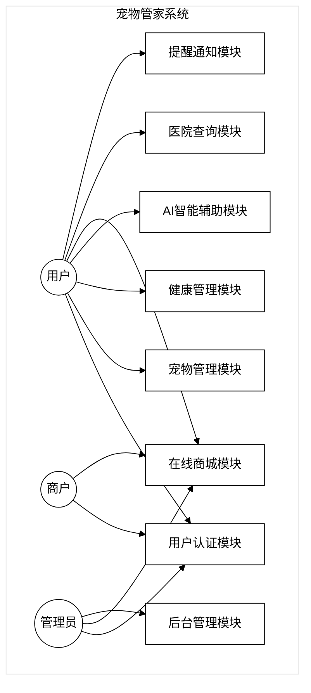
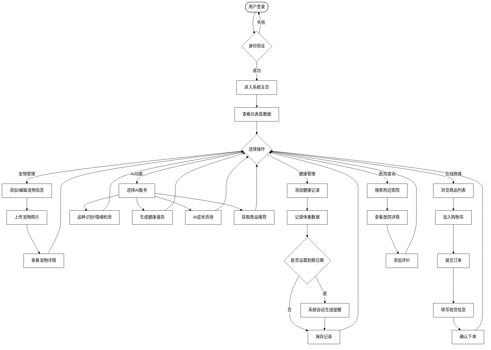
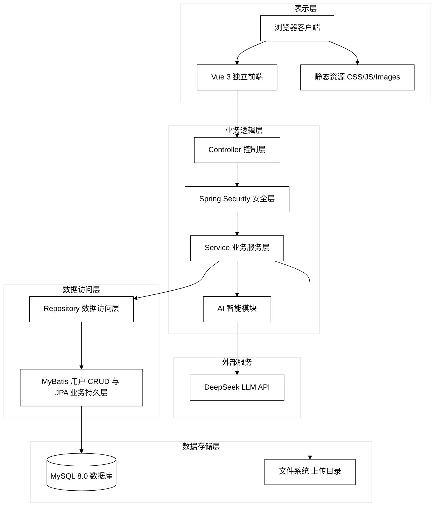
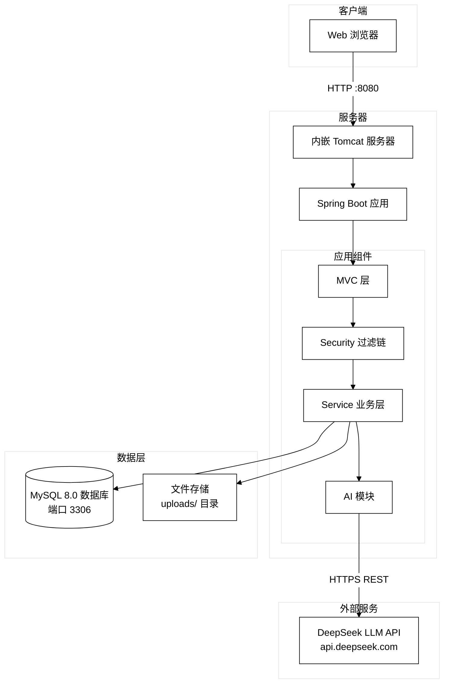
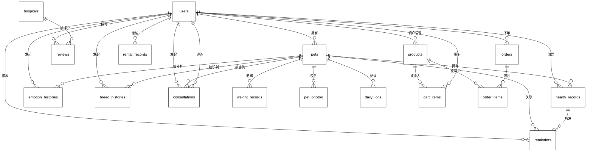
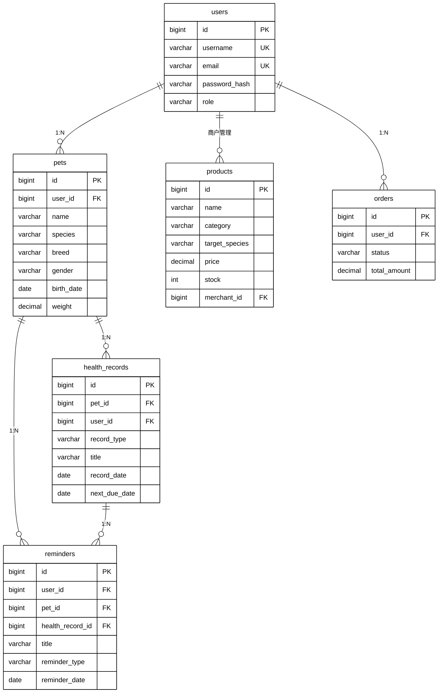
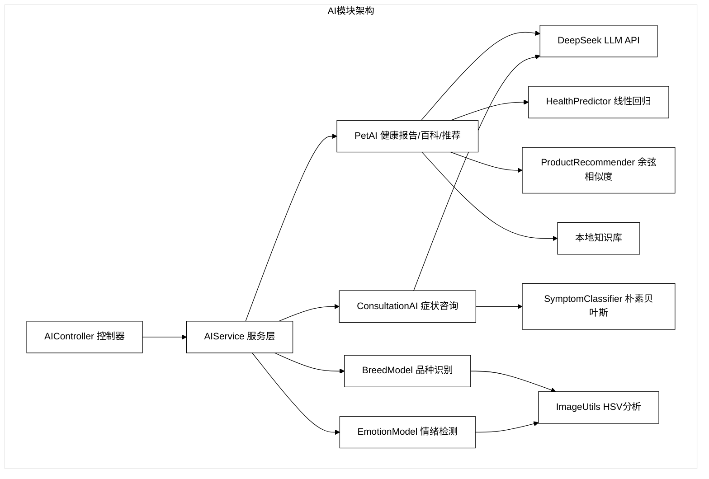
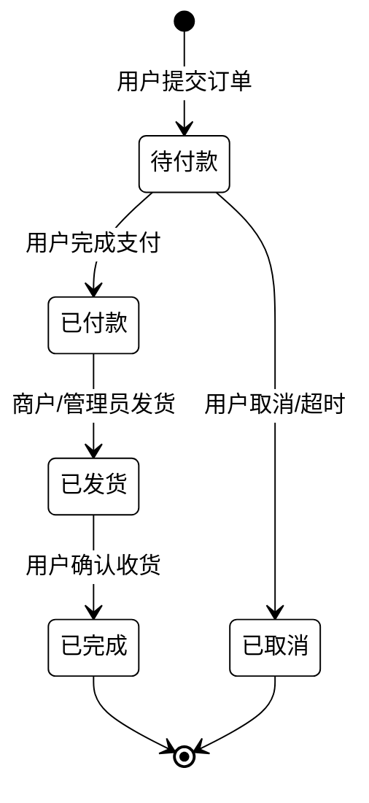
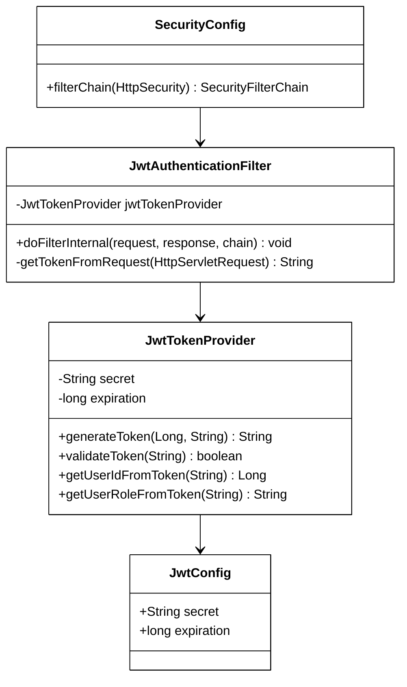

# 宠物管家系统设计与实现

> 学号：202432110227
> 姓名：余柏翰

---

## 摘要

随着我国经济社会的快速发展和居民生活水平的不断提高，宠物已经逐渐成为众多家庭的重要成员。然而，宠物主人在日常管理过程中面临着宠物健康档案缺失、疫苗接种提醒不及时、宠物情绪状态难以判断、宠物用品选购缺乏科学指导等诸多痛点。传统的宠物管理方式依赖人工记录和主观经验，缺乏系统化、智能化的管理手段。

针对以上问题，本文设计并实现了一个基于 Spring Boot 的智能宠物管家系统。系统由三大核心模块组成：其一为宠物日常管理模块，涵盖宠物信息管理、健康档案维护、疫苗接种提醒、体重变化追踪等功能；其二为在线商城模块，支持宠物食品与玩具的浏览、购物车、订单管理等完整电商流程；其三为 AI 智能辅助模块，集成 DeepSeek 大语言模型与本地机器学习算法，提供宠物品种识别、情绪分析、健康报告生成、商品推荐、症状咨询等智能服务。

架构上，系统采用 B/S 三层架构与前后端分离设计，前端基于 Vue 3、Vue Router 与 Axios 构建独立界面，后端依托 Spring Boot 3.4 与 Spring Data JPA 框架开发，持久层选用 MySQL 8.0 存储结构化数据，安全层采用 JWT 认证与服务端撤销校验与 Spring Security 实现权限控制。AI 模块完全基于 Java 实现，包含线性回归健康评分预测、朴素贝叶斯症状分类、余弦相似度商品推荐、HSV 色彩空间品种识别等多个轻量级机器学习模型。

本次改造通过自动测试、接口和页面联调记录验证结果。系统继续提供宠物日常管理与辅助信息；未执行的真实模型调用、远程协作和 MySQL 迁移不记为通过，AI 内容仍需人工核查。

**关键词：** 宠物管理；Spring Boot；人工智能；健康监测；在线商城

---

## Abstract

With the rapid development of China's economy and the continuous improvement of residents' living standards, pets have gradually become important members of many families. However, pet owners face numerous challenges in daily management, including incomplete pet health records, untimely vaccination reminders, difficulty in judging pet emotional states, and lack of scientific guidance for pet product selection. Traditional pet management methods rely on manual records and subjective experience, lacking systematic and intelligent management approaches.

To address these issues, this paper designs and implements an intelligent pet management system based on Spring Boot. The system consists of three core modules: first, a pet daily management module covering pet information management, health record maintenance, vaccination reminders, and weight tracking; second, an online store module supporting complete e-commerce processes including pet food and toy browsing, shopping cart, and order management; third, an AI-assisted module integrating the DeepSeek large language model with local machine learning algorithms to provide intelligent services such as pet breed recognition, emotion analysis, health report generation, product recommendation, and symptom consultation.

Architecturally, the system adopts a B/S three-tier architecture with front-end and back-end separation. The front-end is built with Vue 3, Vue Router and Axios for a responsive interface, the back-end is developed using Spring Boot 3.4 and Spring Data JPA, the persistence layer uses MySQL 8.0 for structured data storage, and the security layer implements JWT stateless authentication with Spring Security for access control. The AI module is entirely implemented in Java, containing multiple lightweight machine learning models including linear regression health score prediction, naive Bayes symptom classification, cosine similarity product recommendation, and HSV color space breed recognition.

The revised implementation is validated using automated tests and local integration checks. Live model calls, remote collaboration and migration against an existing MySQL database require separate evidence. AI-generated content still needs human verification.

**Key words:** Pet Management; Spring Boot; Artificial Intelligence; Health Monitoring; Online Store

---

## 目录

1. [第 1 章 绪论](#第-1-章-绪论)
   - 1.1 [研究背景与意义](#研究背景与意义)
   - 1.2 [国内外研究现状](#国内外研究现状)
   - 1.3 [研究内容与方法](#研究内容与方法)
   - 1.4 [论文组织结构](#论文组织结构)
2. [第 2 章 相关技术介绍](#第-2-章-相关技术介绍)
   - 2.1 [Spring Boot 框架](#spring-boot-框架)
   - 2.2 [Spring Data JPA 与 MySQL](#spring-data-jpa-与-mysql)
   - 2.3 [Spring Security 与 JWT](#spring-security-与-jwt)
   - 2.4 [Vue 前端框架](#thymeleaf-模板引擎)
   - 2.5 [AI 与机器学习技术](#ai-与机器学习技术)
   - 2.6 [Apache Maven 构建工具](#apache-maven-构建工具)
   - 2.7 [Lombok 与开发效率](#lombok-与开发效率)
3. [第 3 章 系统需求分析](#第-3-章-系统需求分析)
   - 3.1 [系统总体需求](#系统总体需求)
   - 3.2 [功能性需求分析](#功能性需求分析)
4. [第 4 章 系统设计](#第-4-章-系统设计)
   - 4.1 [系统总体架构设计](#系统总体架构设计)
   - 4.2 [数据库设计](#数据库设计)
   - 4.3 [功能模块设计](#功能模块设计)
5. [第 5 章 系统实现](#第-5-章-系统实现)
   - 实验一至实验五的实现、验证和 AI 使用记录
6. [第 6 章 系统测试](#第-6-章-系统测试)
   - 综合验证记录与未验证条件
7. [第 7 章 总结与展望](#第-7-章-总结与展望)
   - 7.1 [工作总结](#工作总结)
   - 7.2 [创新点总结](#创新点总结)
   - 7.3 [存在不足](#存在不足)
   - 7.4 [未来展望](#未来展望)
8. [参考文献](#参考文献)
9. [致谢](#致谢)

---

# 第 1 章 绪论

## 1.1 研究背景与意义

近年来，随着我国居民可支配收入的持续增长和城镇化进程的加速推进，宠物经济迎来了爆发式发展。《2025 年中国宠物行业白皮书》数据显示，中国城镇宠物（犬猫）消费市场规模已突破 3000 亿元，宠物数量超过 1.2 亿只。宠物在家庭中的角色逐渐从"看家护院"向"情感陪伴"转变，越来越多的宠物主人将宠物视为家庭成员。

然而，宠物管理领域的信息化建设相对滞后，宠物主人普遍面临以下痛点：第一，宠物健康档案管理混乱，疫苗接种时间、驱虫周期、体检记录等信息分散在纸质单据或手机备忘录中，难以系统化追踪；第二，宠物健康预警能力缺失，多数宠物主人缺乏专业知识，无法及时发现宠物的健康异常；第三，宠物情绪状态难以科学评估，主人仅能通过主观经验判断宠物的情绪变化；第四，宠物用品选购缺乏个性化推荐，市场上商品种类繁多，宠物主人难以快速筛选出适合自己宠物的产品。

在此背景下，本文旨在设计并实现一个集宠物日常管理、在线商城、AI 智能辅助于一体的综合性宠物管家系统。系统预期目标是通过信息化手段帮助宠物主人实现宠物全生命周期的科学管理，利用人工智能技术降低宠物健康管理的专业门槛，为宠物主人提供一站式、智能化的养宠服务。

## 1.2 国内外研究现状

在宠物管理信息化领域，国内外已有一些实践探索。在国际市场，PetDesk、Pawtrack 等宠物健康管理应用已获得广泛用户基础，它们提供疫苗接种提醒、预约兽医等基础功能。Petco 和 Chewy 等综合性平台则将电商与宠物服务进行整合。在学术研究方面，2019 年 McGreevy 等学者提出了基于机器学习的犬类健康风险评估模型；2022 年，Kim 等人利用卷积神经网络实现了猫狗品种的自动识别，准确率达到 93% 以上。

在国内市场，宠物家、波奇宠物、E 宠等平台主要聚焦于宠物电商和洗护美容等 O2O 服务。在宠物健康管理方面，国内产品多以信息记录为主，智能化和个性化程度较低。在学术研究方面，国内学者在宠物行为分析、宠物疾病预测等领域也进行了一定探索，但落地应用的产品相对较少。

综合分析发现，现有宠物管理系统存在以下不足：一是功能相对单一，缺乏覆盖宠物全生命周期的综合管理能力；二是智能化水平有限，多数平台仅提供基础的信息记录功能，缺乏基于人工智能的主动分析和决策辅助；三是国内平台在技术方案上多采用传统架构，在系统可扩展性和可维护性方面存在提升空间。这些不足为本系统的设计和实现指明了方向。

## 1.3 研究内容与方法

本文的研究内容主要从以下四个方面展开：

第一，完成宠物管家系统整体架构设计。采用 Spring Boot 作为核心框架，结合 Spring Data JPA、Spring Security、Vue 等技术栈，构建前后端分离的 B/S 架构应用系统，实现用户认证、权限管理、数据持久化等基础能力。

第二，构建宠物日常管理功能体系。实现宠物信息 CRUD 管理、健康档案维护（疫苗接种、驱虫、体检记录）、智能提醒生成（基于健康记录自动创建后续提醒）、体重变化追踪与可视化、日常日志记录等功能，形成完整的宠物生命周期管理闭环。

第三，搭建在线宠物商城子系统。实现商品分类浏览、购物车管理、订单创建与状态跟踪等完整电商流程。商户用户可管理自有商品，管理员可进行平台运营管理。商城与宠物档案联动，为 AI 推荐提供数据基础。

第四，设计并实现完全基于 Java 的 AI 智能辅助模块。不依赖 Python 运行时，在 Java 环境下独立实现多个轻量级机器学习模型：基于 HSV 色彩空间分析的宠物品种识别、基于多维特征加权的情绪检测、基于线性回归的健康评分预测、基于朴素贝叶斯的症状分类、基于余弦相似度的商品推荐。同时对接 DeepSeek 大语言模型 API，提供健康报告生成、百科问答等高级 AI 服务，并在 API 不可用时自动降级为本地模型。

研究方法上，采用系统化、工程化的开发方式。需求分析阶段通过文献研究、竞品分析确定目标用户核心需求。系统设计阶段采用结构化方法，从总体架构、数据库结构、模块划分三个维度进行详细设计。技术选型阶段根据功能场景、性能指标和可维护性要求确定最终技术组合。开发阶段采用增量迭代方式，逐步交付各功能模块。测试阶段采用黑盒功能测试方法，保证系统的功能完整性和运行稳定性。

## 1.4 论文组织结构

本文共分为七章。各章节之间层层递进、相互关联，从理论分析到技术选型，从需求梳理到架构设计，再从功能实现到测试验证，形成了一条完整的系统开发主线。

第 1 章绪论，介绍研究背景与意义、国内外研究现状、研究内容与方法。

第 2 章相关技术介绍，对系统开发中涉及的主要技术和工具进行详细介绍，包括 Spring Boot 框架、Spring Data JPA、Spring Security、JWT 认证、Vue 前端框架以及 AI 与机器学习相关技术。

第 3 章系统需求分析，从系统总体需求和功能性需求两个层面进行详细分析，明确系统的功能边界和用户角色。

第 4 章系统设计，介绍系统总体架构设计、数据库设计（概念结构与逻辑结构）和功能模块设计。

第 5 章系统实现，对系统开发环境搭建、核心功能实现过程及关键技术细节进行说明。

第 6 章系统测试，介绍系统测试环境、功能测试方案及测试结果。

第 7 章总结与展望，总结研究工作，归纳创新点，分析存在的不足，并对未来改进方向进行展望。

---

# 第 2 章 相关技术介绍

## 2.1 Spring Boot 框架

Spring Boot 是由 Pivotal 团队（现隶属于 VMware）开发的基于 Spring 框架的快速应用开发框架。其核心设计理念是"约定优于配置"（Convention over Configuration），通过自动配置（Auto-Configuration）机制大幅简化了 Spring 应用的搭建和开发过程。

Spring Boot 的主要特性包括：内嵌 Tomcat、Jetty 等 Servlet 容器，无需部署 WAR 文件即可独立运行；提供 starter 依赖管理，一站式引入相关技术栈；Actuator 模块提供生产就绪的监控和管理端点；支持外部化配置，可通过 application.yml、环境变量等多种方式管理配置参数。

本系统在原有 Spring Boot 3.4.5 基础上实施改造，Maven 使用 Java 17 release 编译目标与 Jakarta 命名空间。保留 JPA 业务数据访问，并新增 MyBatis 用户管理，满足本次 Web 基础项目实验。

## 2.2 MyBatis Spring Data JPA 与 MySQL

新增用户管理通过 MyBatis Mapper 执行参数化 SQL，Service 负责事务和密码哈希。其余领域模型保留 JPA 映射；两者使用同一数据源，避免重复维护两套业务用户。

Spring Data JPA 是 Spring Data 项目的重要组成部分，它在 JPA（Jakarta Persistence API）规范之上提供了更高层次的抽象。通过定义 Repository 接口并继承 JpaRepository，开发者无需编写实现类即可获得常用的 CRUD 操作、分页查询、排序查询等功能。Spring Data JPA 还支持方法命名规则查询（Query Derivation），即根据方法名自动生成 JPQL 查询语句。

JPA 的核心概念包括：实体（Entity），将 Java 对象映射到数据库表；实体管理器（EntityManager），管理实体的生命周期；JPQL（Jakarta Persistence Query Language），面向对象的查询语言；以及关联映射（@OneToMany、@ManyToOne、@ManyToMany 等注解），定义实体间的关系。

MySQL 8.0 是目前最流行的开源关系型数据库之一。8.0 版本引入了窗口函数、公用表表达式（CTE）、JSON 增强支持、角色管理等诸多新特性，在性能、安全性和功能丰富度方面较 5.7 版本有显著提升。本系统使用 InnoDB 存储引擎，利用其事务支持（ACID）、行级锁定和外键约束等特性保证数据一致性和完整性。数据库连接管理采用 HikariCP 连接池（Spring Boot 默认），提供高性能的数据库连接复用。

## 2.3 Spring Security 与 JWT

Spring Security 是 Spring 生态系统中负责认证（Authentication）和授权（Authorization）的安全框架。它基于过滤器链（Filter Chain）机制拦截 HTTP 请求，通过 SecurityFilterChain Bean 配置安全策略。Spring Security 6.x 采用全新的 Lambda DSL 配置风格，替代了旧版本中已废弃的链式调用方式。

本系统采用 JWT（JSON Web Token）实现无状态身份认证。JWT 是一种基于 JSON 的开放标准（RFC 7519），用于在各方之间安全地传输信息。其核心结构由三部分组成：Header（头部），描述令牌类型和签名算法；Payload（负载），包含用户身份信息、过期时间等声明；Signature（签名），使用服务端密钥对前两部分进行签名，确保令牌的完整性和不可篡改性。

认证流程如下：用户提交凭据及 CSRF 请求头，后端使用 BCrypt 验证密码并通过 HttpOnly Cookie 签发 JWT。后续请求由浏览器携带 Cookie；过滤器校验签名、有效期和撤销状态，再从数据库读取权限。Controller/Service 检查接口权限和对象归属。前端不在 localStorage 或 sessionStorage 保存 JWT。

## 2.4 Vue 与前后端分离

本次实训将受支持的前端迁移到独立的 Vue 3 工程，使用 Vue Router 管理页面、Axios 调用 JSON 接口、Vite 完成开发代理与构建。宠物、商城和 AI 业务入口继续保留，前后端可分别部署。

旧 Thymeleaf 模板保留为历史参考；原页面路由转向 Vue，不再作为受支持的业务前端。接口配置 CORS 白名单，Cookie JWT 配套 CSRF 保护，前端不在浏览器存储中保存可读令牌。

## 2.5 AI 与机器学习技术

本系统在 AI 模块的技术选型上采用"大语言模型 + 本地 ML 模型"的双轨架构，兼顾了智能性和可靠性。

在本地机器学习模型方面，本系统完全基于 Java 实现，不依赖 Python 运行时，利用 Apache Commons Math 3 数学计算库进行矩阵运算和统计分析。具体实现了以下模型：

- **Linear Regression（线性回归）**：用于健康评分预测，输入特征包括物种、年龄、体重、疫苗次数、驱虫次数、体检次数、体重变化趋势、品种遗传风险等 8 个维度，输出 1-10 分的健康评分。模型基于 500 条合成宠物健康数据训练，使用最小二乘法求解参数。

- **Naive Bayes Classifier（朴素贝叶斯分类器）**：用于症状到疾病的条件概率推断，采用中文关键词分词 + Laplace 平滑处理的贝叶斯公式，从症状描述中匹配最可能的疾病类型并输出护理建议。

- **Cosine Similarity（余弦相似度）**：用于宠物商品推荐，将宠物的物种、年龄、体重构建为特征向量，计算与商品库中各商品的向量夹角余弦值，按相似度降序排列输出推荐结果。

- **HSV Color Space Analysis（HSV 色彩空间分析）**：用于猫咪品种识别，通过分析图像的主色调、色彩分布等 HSV 特征，结合边缘检测算法，与品种知识库进行匹配识别。

在大语言模型方面，系统对接 DeepSeek API（兼容 OpenAI 接口格式），用于生成详细的中文健康分析报告、回答宠物百科问答、提供商品推荐理由等需要自然语言生成的场景。当 API 不可用（如网络故障、API Key 未配置）时，系统自动降级为本地 ML 模型输出，保证功能可用性。

## 2.6 Apache Maven 构建工具

Apache Maven 是 Java 生态中最广泛使用的项目构建和依赖管理工具。与传统的 Ant 或手动管理 jar 包的开发方式相比，Maven 通过 POM（Project Object Model）文件声明式地定义项目的依赖关系、构建生命周期和插件配置，大幅简化了项目管理工作。

Maven 的核心概念包括：坐标（GroupId + ArtifactId + Version），在 Maven 中央仓库中唯一标识一个构件；依赖传递（Transitive Dependency），自动解析和引入间接依赖，避免手动管理复杂的依赖树；构建生命周期（Build Lifecycle），定义了 validate、compile、test、package、verify、install、deploy 等标准构建阶段；插件体系，通过插件扩展构建能力，如 maven-compiler-plugin 控制编译参数、spring-boot-maven-plugin 支持可执行 jar 打包。

本系统使用 Maven Wrapper（mvnw）确保所有开发者使用相同版本的 Maven，避免了因 Maven 版本差异导致的构建问题。依赖管理方面，通过 Spring Boot Starter 父 POM 统一管理核心依赖版本，仅对 JWT、Commons Math 等特殊依赖显式声明版本号。

## 2.7 Lombok 与开发效率

Lombok 是一个 Java 编译时注解处理器，通过在编译阶段自动生成样板代码（Boilerplate Code），显著减少 Java 类的代码量。Lombok 的核心注解包括：

- **@Data**：组合注解，等效于同时使用 @Getter、@Setter、@ToString、@EqualsAndHashCode 和 @RequiredArgsConstructor，适用于实体类和 DTO。
- **@Builder**：生成 Builder 模式代码，支持链式调用构建复杂对象，提高代码可读性。
- **@NoArgsConstructor / @AllArgsConstructor**：生成无参/全参构造函数，满足 JPA 实体和 Jackson 序列化的要求。
- **@Slf4j**：自动注入 SLF4J 日志对象，简化日志代码编写。

在本系统中，所有 JPA 实体类均使用 @Data + @NoArgsConstructor + @AllArgsConstructor 注解组合，相比手写 getter/setter/构造器等方法，每个实体类平均减少 60-100 行代码。Service 层使用 @Slf4j 进行日志输出，避免在每个类中重复声明 Logger 对象。

需要注意的是，Lombok 需要在 IDE 中安装对应的插件才能正确识别生成的代码，且在 Maven 编译配置中需要通过 annotationProcessorPaths 显式指定 Lombok 的注解处理器路径。

---

# 第 3 章 系统需求分析

## 3.1 系统总体需求

本系统的主要用户群体包括以下三类：

1. **普通宠物主人**：需要进行宠物信息管理、健康记录维护、查看提醒通知、使用 AI 识别和分析功能、浏览和购买宠物商品。

2. **商户用户**：入驻平台的宠物用品商家，需要管理自有商品、查看销售订单、缴纳平台租金。

3. **系统管理员**：进行平台运营管理，包括用户管理、宠物管理、商户审批、商品审核、租金收取等。

根据对目标用户需求的调研和分析，系统在总体上需要满足以下要求：提供直观友好的 Web 操作界面，降低使用门槛；覆盖宠物从添加、日常管理到健康追踪的全生命周期；集成 AI 智能辅助功能，提高宠物健康管理的科学性和便捷性；搭建在线商城，满足宠物主人的一站式购物需求；在架构上保证良好的可扩展性和可维护性，支持后续功能迭代和技术升级。

## 3.2 功能性需求分析

系统整体划分为七大功能模块，各模块职责独立但通过数据层面相互关联，共同构成一套完整的宠物管理生态体系。图 3-1 为系统功能模块的层次化结构总览，图 3-2 为系统用例图。

```mermaid
%%{init: {'theme': 'base', 'themeVariables': {'primaryColor': '#ffffff', 'primaryTextColor': '#000000', 'primaryBorderColor': '#000000', 'lineColor': '#000000', 'secondaryColor': '#ffffff', 'tertiaryColor': '#ffffff', 'noteBkgColor': '#ffffff', 'noteTextColor': '#000000'}}}%%
graph TB
    A[宠物管家系统] --> B[用户认证模块]
    A --> C[宠物管理模块]
    A --> D[健康管理模块]
    A --> E[AI智能辅助模块]
    A --> F[在线商城模块]
    A --> G[医院查询模块]
    A --> H[后台管理模块]

    B --> B1[注册]
    B --> B2[登录]
    B --> B3[个人中心]
    B --> B4[密码修改]

    C --> C1[宠物档案CRUD]
    C --> C2[宠物列表展示]
    C --> C3[头像上传]
    C --> C4[品种/年龄计算]

    D --> D1[健康记录管理]
    D --> D2[体重追踪]
    D --> D3[提醒自动生成]
    D --> D4[附件上传]

    E --> E1[品种识别]
    E --> E2[情绪检测]
    E --> E3[健康报告生成]
    E --> E4[商品智能推荐]
    E --> E5[症状AI咨询]

    F --> F1[商品浏览与筛选]
    F --> F2[购物车管理]
    F --> F3[订单管理]
    F --> F4[商户商品管理]

    G --> G1[医院列表查询]
    G --> G2[就近搜索]
    G --> G3[用户评价]

    H --> H1[用户管理]
    H --> H2[宠物管理]
    H --> H3[商户审批]
    H --> H4[租金管理]
```



**图 3-1 系统功能模块结构图**



**图 3-2 系统用例图**

### 3.2.1 用户认证模块

用户认证模块是系统的入口模块，负责用户身份注册、登录认证和个人信息管理。支持三种角色注册：普通用户通过邮箱和用户名注册；商户用户在普通注册基础上额外填写店铺信息；管理员由系统预置，不可自行注册。

登录采用 JWT 认证与服务端撤销校验，用户提交用户名/邮箱和密码后，服务端验证身份并返回 JWT 令牌。令牌有效期为 7 天，过期后需要重新登录。个人中心支持查看和修改个人资料、修改密码、上传头像等操作。

### 3.2.2 宠物管理模块

宠物管理模块是系统的核心模块之一，管理宠物从添加到归档的完整过程。用户可以为名下添加多只宠物，每只宠物的基本信息包括：名称、物种（狗/猫）、品种、性别、出生日期、体重、毛色、头像照片和个性描述。

宠物列表支持分页浏览，点击宠物可查看详情页面。系统根据出生日期自动计算宠物的年龄（以岁和月为单位的可读格式），并在详情页展示。用户可以随时编辑宠物信息或删除宠物档案，删除操作会级联清理关联的头像文件、健康记录和提醒数据。

### 3.2.3 健康管理模块

健康管理模块负责宠物健康档案的维护与追踪。健康记录分为三种类型：疫苗接种（vaccine）、驱虫处理（deworming）和体检记录（checkup）。每条记录包含标题、类型、记录日期、下次到期日期、兽医信息、备注描述和附件上传功能。

体重记录独立管理，用户可以按日期记录宠物体重变化，系统以列表形式展示体重历史，便于用户追踪宠物体重趋势。健康记录和体重记录共同为 AI 健康报告生成提供数据基础。

当健康记录中填写了下次到期日期（next_due_date）字段时，系统自动在提醒表中创建对应的提醒记录，提醒用户在到期日关注相关健康事项。

### 3.2.4 AI 智能辅助模块

AI 智能辅助模块是系统的核心智能功能集群，提供以下五项主要能力：

1. **品种识别**：用户上传宠物照片后，系统通过 HSV 色彩空间分析和边缘检测算法识别猫咪品种，返回品种名称、置信度和饲养建议。

2. **情绪检测**：用户上传宠物照片后，系统通过多维特征分析判断宠物的情绪状态（开心、放松、警觉、焦虑、害怕、疲劳、难过），输出情绪类型、置信度和安抚建议。

3. **健康报告生成**：系统综合宠物的品种、年龄、体重、健康记录和体重历史，调用 AI 模型生成详细的中文健康分析报告，涵盖健康评分、保健记录分析、品种遗传风险评估和饮食运动建议。

4. **商品智能推荐**：基于宠物的品种、年龄、体重特征和商品库数据，利用余弦相似度算法计算最佳匹配商品，输出个性化推荐列表。

5. **症状咨询**：用户描述宠物症状后，系统首先调用 DeepSeek 大模型获取 AI 建议；如果 API 不可用，自动降级为朴素贝叶斯分类器的本地推理结果。

所有 AI 识别和分析结果均保存历史记录，用户可随时回顾查看。

### 3.2.5 在线商城模块

在线商城模块实现完整的 B2C 电商功能。商品分为宠物食品（food）和宠物玩具（toy）两个类别，可按物种（狗狗专用/猫咪专用/猫狗通用）进行筛选。

购物流程为：用户浏览商品列表 → 查看商品详情 → 添加到购物车 → 修改购物车商品数量 → 填写收货信息 → 提交订单 → 订单状态跟踪。订单状态流转为：待付款 → 已付款 → 已发货 → 已完成，支持取消订单操作。

商户用户在其名下创建和管理商品，可编辑商品信息、上下架商品。系统管理员可查看所有商户的租金缴纳记录并登记收款。

### 3.2.6 医院查询模块

医院查询模块提供宠物医院信息浏览和搜索功能。医院数据包含名称、地址、联系电话、经纬度坐标、评分等信息。支持基于地理位置的就近搜索，使用 Haversine 公式在 SQL 层面计算距离。用户可为医院添加评分和文字评价。

### 3.2.7 功能需求列表

**表 3-1 功能性需求列表**

| 功能模块 | 主要功能 | 功能描述 |
|:---------|:---------|:---------|
| 用户认证 | 注册登录 | 支持普通用户和商户注册，邮箱+用户名唯一性校验 |
| 用户认证 | 个人中心 | 查看/修改个人资料、修改密码、上传头像 |
| 宠物管理 | 宠物 CRUD | 添加、编辑、删除宠物，涵盖基本信息配置 |
| 宠物管理 | 宠物列表 | 分页展示用户所有宠物，支持头像预览 |
| 健康管理 | 健康记录 | 疫苗、驱虫、体检三种类型记录的增删改查 |
| 健康管理 | 体重追踪 | 按日期记录体重，列表展示体重变化趋势 |
| 健康管理 | 记录附件 | 支持上传健康记录附件（如检验报告照片） |
| AI 辅助 | 品种识别 | 上传照片识别猫咪品种，保存识别历史 |
| AI 辅助 | 情绪检测 | 上传照片分析宠物情绪状态，保存分析历史 |
| AI 辅助 | 健康报告 | 综合多维数据生成详细健康分析报告 |
| AI 辅助 | 商品推荐 | 基于宠物特征推荐适合的商城商品 |
| AI 辅助 | 症状咨询 | 输入症状描述获取 AI 诊断建议 |
| 在线商城 | 商品浏览 | 分页浏览、按物种和类别筛选商品 |
| 在线商城 | 购物车 | 添加、修改数量、删除、清空购物车 |
| 在线商城 | 订单管理 | 创建订单、查看订单列表、状态跟踪 |
| 在线商城 | 商户管理 | 商户创建编辑商品、查看订单 |
| 医院查询 | 医院列表 | 浏览医院信息，查看评分和评价 |
| 医院查询 | 就近搜索 | 基于经纬度搜索附近宠物医院 |
| 医院查询 | 用户评价 | 为医院添加评分和文字评价 |
| 提醒通知 | 自动提醒 | 根据健康记录自动生成后续提醒 |
| 提醒通知 | 提醒管理 | 查看未读提醒、标记已读、关闭提醒 |
| 后台管理 | 数据统计 | 管理员查看平台用户、宠物、订单统计 |
| 后台管理 | 用户管理 | 管理员查看和审批用户、商户 |
| 后台管理 | 租金管理 | 管理员收取和记录商户租金 |

**表 3-1 功能性需求列表**

图 3-3 展示了系统核心用户（宠物主人）的主要业务活动流程，从登录系统到完成宠物管理与购物的完整活动链路。



**图 3-3 系统核心业务活动图**

---

# 第 4 章 系统设计

系统设计是将需求分析阶段确定的功能需求转化为具体系统实现方案的过程。本章将从系统总体架构设计、数据库设计和功能模块设计三个方面，对本系统的设计思想和实现方案进行详细阐述。

## 4.1 系统总体架构设计

本系统采用经典的 B/S 三层架构与 MVC 设计模式相结合，整体遵循"高内聚、低耦合"的设计原则。图 4-1 展示了系统的三层架构设计。



**图 4-1 系统总体架构图**

各层职责如下：

**表示层**由独立 Vue 工程提供，沿用宠物管理、照护、医院、商城和 AI 服务的业务入口。Vue Router 管理路由，Axios 调用 REST API，Vite 支持独立构建。旧模板作为参考保留，不再承担受支持的业务交互。

**业务逻辑层**是系统的核心，完成所有业务逻辑处理。Controller 层接收 HTTP 请求，进行参数校验和路由分发；Service 层封装业务逻辑，协调多个 Repository 完成复杂业务操作；AI 模块独立于 Service 层，提供品种识别、情绪检测、健康预测等智能算法能力；Security 层通过 JWT 过滤器拦截请求，实现无状态认证和权限校验。

**数据访问层**负责与数据库的交互操作。基于 Spring Data JPA 的 Repository 接口定义数据访问方法，Hibernate 作为 JPA 的实现提供 ORM 映射能力。使用连接池管理数据库连接，通过 @Transactional 注解保证事务一致性。

**数据存储层**包含 MySQL 关系型数据库和文件系统两部分。结构化业务数据（用户、宠物、健康记录等）存储在 MySQL 中，非结构化的文件数据（用户头像、宠物照片、上传附件等）存储在服务器的文件系统中。

图 4-2 展示了系统的部署架构，描述了从用户客户端到服务端各组件之间的物理部署关系。



**图 4-2 系统部署架构图**

## 4.2 数据库设计

### 4.2.1 概念结构设计

本系统数据库设计包含 18 个数据表，涵盖用户认证、宠物管理、健康追踪、商城交易、AI 分析、医院评价等全部业务域。图 4-3 为数据库实体关系图（ER 图），展示了核心数据表及其之间的关联关系。



**图 4-3 数据库 ER 图**

实体间的主要关系说明如下：

- **User 与 Pet**：一对多关系。一个用户可以创建多个宠物档案，宠物删除时级联删除关联的子数据。
- **Pet 与 HealthRecord**：一对多关系。一个宠物可以有多条健康记录（疫苗、驱虫、体检）。
- **Pet 与 WeightRecord**：一对多关系。一个宠物可以有多条体重记录。
- **Pet 与 EmotionHistory / BreedHistory**：一对多关系。一个宠物可以被多次 AI 分析。
- **HealthRecord 与 Reminder**：一对多关系。健康记录中的下次到期日期自动生成提醒。
- **Product 与 CartItem / OrderItem**：一对多关系。商品可以被多个用户加入购物车或购买。
- **Order 与 OrderItem**：一对多关系。一个订单包含多个订单项。
- **Hospital 与 Review**：一对多关系。一个医院可以有多条用户评价。
- **User 与 Consultation**：一对多关系。一个用户可以发起多次症状咨询。

### 4.2.2 逻辑结构设计

以下为系统核心数据表的逻辑结构设计：

**表 4-1 核心数据表结构**

| 表名 | 主要字段 | 说明 |
|:-----|:---------|:-----|
| users | id, username, email, password_hash, phone, avatar, role, is_admin, store_name, store_phone, rent_amount, rent_due_day, is_approved, created_at | 用户认证与角色信息，商户额外包含店铺和租金配置 |
| pets | id, user_id, name, species, breed, gender, birth_date, age, weight, color, avatar, description, created_at | 宠物基本信息，species 为 dog/cat，外键关联用户 |
| health_records | id, pet_id, user_id, record_type, title, description, record_date, next_due_date, veterinarian, notes, attachment_path, created_at | 健康档案，record_type 为 vaccine/deworming/checkup |
| weight_records | id, pet_id, weight, record_date, note, created_at | 体重记录，按日期追踪体重变化 |
| reminders | id, user_id, pet_id, health_record_id, title, reminder_type, reminder_date, is_read, is_dismissed, created_at | 提醒通知，由健康记录的 next_due_date 自动生成或手动创建 |
| products | id, name, category, target_species, description, price, stock, image, is_active, merchant_id, created_at | 商城商品，category 为 food/toy，target_species 为 dog/cat/both |
| cart_items | id, user_id, product_id, quantity, created_at | 购物车，user_id + product_id 唯一约束 |
| orders | id, user_id, status, total_amount, note, recipient_name, recipient_phone, address_province, address_city, address_district, address_detail, created_at | 订单主表，status 为 pending/paid/shipped/delivered/cancelled |
| order_items | id, order_id, product_id, product_name, price, quantity, created_at | 订单明细，快照商品名称和价格 |
| hospitals | id, name, address, phone, latitude, longitude, description, image, rating, review_count, created_at | 宠物医院信息，含经纬度用于就近搜索 |
| reviews | id, user_id, hospital_id, rating, content, created_at | 医院用户评价，rating 为 1-5 整数 |
| consultations | id, user_id, pet_id, species, symptoms, duration, advice, matched_conditions, severity, created_at | AI 症状咨询记录 |
| breed_histories | id, user_id, pet_id, image_path, recognized_breed, confidence, description, care_tips, created_at | 品种识别历史 |
| emotion_histories | id, user_id, pet_id, image_path, emotion, confidence, comfort_advice, created_at | 情绪检测历史 |
| rental_records | id, merchant_id, amount, period_start, period_end, paid_at, collected_by, payment_method, transaction_id, note, created_at | 商户租金缴纳记录 |

数据模型设计采用"宠物为核心、用户为边界"的设计思想。所有宠物相关的数据（健康记录、体重、提醒、AI 分析等）均通过 pet_id 与宠物档案直接关联，用户只能访问自己名下的数据。商城模块采用独立的数据域设计，商品与宠物档案通过 AI 推荐功能在应用层关联而非数据库层硬关联。测试用例与套件之间的关系设计为多对多，通过关联表维护，实现用例的高复用性。

核心数据模型关系如图 4-4 所示：



**图 4-4 数据模型关系图**

## 4.3 功能模块设计

### 4.3.1 宠物管理模块设计

宠物管理模块采用经典的分层架构：Controller 层处理 HTTP 请求和参数校验，Service 层封装业务逻辑，Repository 层负责数据持久化。Pet 实体包含 16 个属性字段，其中 birth_date 和 weight 为关键健康数据维度。模块提供自动年龄计算功能，通过 ChronoUnit 计算出生日期到当前时间的月份差，转换为"X岁Y个月"的人类可读格式。

### 4.3.2 健康管理模块设计

健康管理模块由 HealthRecord 和 WeightRecord 两个核心实体构成。HealthRecord 使用 record_type 字段区分疫苗、驱虫和体检三种类型，每种类型有不同的管理逻辑。当用户创建或编辑健康记录并填写了 next_due_date 字段时，系统自动在 Reminder 表中生成对应的提醒记录。提醒生成逻辑在 Service 层实现，通过 @Transactional 注解保证健康记录保存与提醒创建在同一个事务中完成。

### 4.3.3 AI 智能辅助模块设计

AI 智能辅助模块是本系统技术含量最高的功能模块。如图 4-4 所示，模块采用分层协作架构。



**图 4-5 AI 模块架构图**

AI 控制器接收前端请求后，进行参数校验和权限判断，然后委托给 AI 服务层。AI 服务层作为中央调度器，根据功能类型路由到对应的算法模块。大语言模型客户端封装了与 DeepSeek API 的所有交互细节，包括请求构建、超时处理、异常捕获和结果解析。当大模型 API 不可用时，系统自动降级为本地 ML 模型的推理结果。

品种识别使用 HSV 色彩空间转换和边缘检测算法。首先将图片转换为 HSV 色彩空间，提取主色调和色彩分布特征，结合 Sobel 边缘检测算子和拉普拉斯算子计算边缘密度，最后与品种知识库中的特征模板进行加权匹配。

情绪检测采用多维特征评分 + Softmax 归一化的方法。从图像中提取亮度分布、纹理复杂度、色彩温暖度等特征，对每种情绪类型计算加权得分，通过 Softmax 函数转换为概率分布。

健康评分预测使用多元线性回归模型。模型在初始化时加载 500 条合成宠物健康数据，使用最小二乘法求解回归系数。预测时输入 8 个特征维度，输出 1-10 分的标准化健康评分。

商品推荐使用余弦相似度算法。将宠物的特征（物种、年龄、体重归一化后）构建为用户向量，将商品的特征（类别、目标物种、适用体重范围）构建为商品向量，计算向量夹角的余弦值作为相似度，按降序排列返回 Top-5 推荐结果。

### 4.3.4 商城模块设计

商城模块模拟完整的 B2C 电商流程，支持商品管理、购物车、订单三个子功能域。商品管理支持 CRUD 操作，商户只能管理自己的商品，管理员拥有全局管理权限。购物车使用 user_id + product_id 唯一约束，避免重复添加同一商品。订单创建时进行库存校验和扣减，支持订单状态流转管理。

订单状态是商城模块的核心业务逻辑。图 4-6 展示了订单从创建到完结的完整状态转换关系，系统共定义了 5 个订单状态，各状态之间的转换遵循严格的业务规则。



**图 4-6 订单状态转换图**

订单各状态说明：待付款（pending）是订单创建后的初始状态，此时库存已预扣；已付款（paid）表示用户完成支付，商户可进行发货操作；已发货（shipped）表示商品已发出，等待用户确认；已完成（delivered）表示交易顺利完结；已取消（cancelled）表示订单被取消，系统自动恢复库存。

### 4.3.5 安全模块设计

安全模块基于 Spring Security 6.x + JWT 实现。核心设计要点包括：CSRF 保护关闭（因为采用无状态 JWT 认证）；Session 管理策略设置为 STATELESS；公开端点（登录、注册、静态资源等）通过 permitAll() 放行；API 端点统一要求认证；JwtAuthenticationFilter 在 UsernamePasswordAuthenticationFilter 之前插入过滤器链，实现每次请求的 JWT 令牌解析和身份注入。

图 4-7 展示了安全模块的核心组件及其依赖关系：



**图 4-7 安全认证模块类图**

---

# 第 5 章 系统实现

本章按第二部分个人技能实训组织，五个实验合并交付一份综合报告。原业务背景、需求和数据模型继续保留。

## 实验一 搭建 Web 基础项目

### 目标与主要步骤

在保留宠物管家业务的基础上，整理 Maven 项目与数据源配置，完成用户表 CRUD，并通过内嵌容器运行后端。

1. 将 Maven 的 source、target、release 统一设置为 17，保留 Spring Boot Web、Validation、Security、MySQL 等依赖，增加 MyBatis 与 OpenAPI。
2. 在 application.yml 中使用环境变量读取数据库密码和 JWT 密钥。演示配置单独放入 application-demo.yml，仅连接内存数据库。
3. 使用已有 users 表。AdminUserRequest 校验请求字段，AdminUserMapper 使用参数绑定执行 SQL，AdminUserService 负责密码哈希、事务与角色关系，AdminUserController 负责 HTTP 响应。
4. 管理员调用 /api/admin/users 完成新增、列表、详情、更新和删除。重复用户名/邮箱返回冲突，存在关联业务的用户拒绝删除。
5. 执行 Maven 测试与打包，再运行 jar 验证服务启动。管理员页面展示真实接口数据。

```powershell
mvn.cmd -Dmaven.repo.local=.m2repo verify
java -jar target/pet-mgmt-java-1.0.0.jar --spring.profiles.active=demo
```

### 关键代码说明

MyBatis 使用 #{...} 绑定参数，避免将用户输入拼接成 SQL。创建用户时先计算 BCrypt 哈希，再将用户和角色关系放入同一事务；返回 DTO 不包含 passwordHash。

```java
@Transactional
public User create(AdminUserRequest request) {
    User user = copy(request, new User());
    user.setIsApproved(true);
    users.insert(user);
    roles.assign(user.getId(), user.getRole());
    return users.find(user.getId());
}
```

以上节选自 AdminUserService，省略了前置密码校验。Controller 与 Service 分开后，数据库异常能够先触发事务回滚，再转换为可理解的接口错误；不能在事务内部吞掉异常后仍声称写入成功。


### 验证与总结反思

自动验证检查用户新增、查询、修改、删除、重复数据和关联删除限制。浏览器验证管理员页面与真实接口联动。H2 能验证本次 CRUD 和权限链路，但无法证明所有 MySQL 方言和已有数据库迁移均正确；部署前需备份并检查迁移脚本。

本实验的重点是理解请求如何穿过各层，而非仅让脚手架启动。需要能够解释为什么密码不直接入库、为什么参数绑定不同于字符串拼接，以及事务何时回滚。

### AI 工具使用记录

工具：Codex。环节：盘点旧工程、生成分层实现与测试、检查事务边界。提示词要点：保留现有 users 表和业务数据，新增 MyBatis CRUD，密码 BCrypt，禁止返回密码或令牌。验证：编译和集成测试、管理员页面操作，并人工审查 SQL、DTO 与事务边界。学生仍需自行理解并讲解代码。

## 实验二 前后端分离与 RESTful API

### 目标与主要步骤

1. 建立 frontend 独立工程，使用 Vue 组件与路由替换原有页面交互，继续呈现宠物管家业务。
2. Axios 使用统一 /api 前缀、超时、凭据和错误提示；开发环境由 Vite 代理连接 8080 后端，部署环境可设置独立 API 地址。
3. 整理宠物、医院和商城的 JSON 接口，补充健康、提醒、体重、日志、相册等子资源接口，并校验宠物归属。
4. 后端配置 CORS 白名单；对携带 Cookie 的跨域请求不使用任意来源通配符。前后端分别构建，再通过真实浏览器联调。
5. 通过 OpenAPI 查看接口结构，人工核对请求字段、返回值和错误边界。

```javascript
const api = axios.create({
  baseURL: import.meta.env.VITE_API_BASE_URL || '/api',
  withCredentials: true
})
```

该代码展示统一客户端的核心配置，实际实现还包含超时、CSRF 请求头和错误处理。withCredentials 允许浏览器按规则携带 Cookie，不意味着 JavaScript 可以读取 HttpOnly JWT。


### 验证与总结反思

验证涵盖页面构建、表单提交、接口错误、宠物档案、照护记录、购物车与订单等流程。宠物图片、用户数据和业务规则不应因为视图技术迁移而丢失。

联调中需要区分三类问题：请求没有到达后端、后端拒绝权限或字段、前端没有正确展示返回值。仅凭页面外观无法证明功能完成；网络响应、数据库结果和页面状态应对应。

本次真实浏览器曾因 127.0.0.1 与 localhost 不同源而被 CORS 拒绝。修正采用精确来源白名单，并测试第三方来源仍被拒绝；连续写操作重新获取 CSRF，避免沿用已轮换的旧值。

### AI 工具使用记录

工具：Codex。环节：Vue 组件、Axios 调用、缺失接口和界面检查。提示词要点：保留原有模块，不用旧网页嵌入代替 Vue，实现真实业务操作并处理错误。验证：前端测试与构建、接口返回核对、浏览器操作和真实页面截图。

## 实验三 Git 协作开发与持续集成

### 目标与主要步骤

1. 初始化 Git 并建立原始代码基线，创建 feature/personal-training 分支。排除依赖、构建输出、真实环境文件和上传数据。
2. 在独立练习仓库创建 feature/a 和 feature/b，分别修改同一行，执行 merge 复现内容冲突。
3. 查看冲突标记后合并双方内容，提交解决结果，并核对提交图和干净工作区。原始命令输出保存在 docs/evidence/git-exercise.txt。
4. 增加 PR 模板，要求填写问题、验证、AI 使用记录和真实人工评审结论。
5. 配置 GitHub Actions：后端运行 Maven verify，前端运行 npm ci、npm test、npm run build；失败时仍保存后端测试报告。

```yaml
jobs:
  backend:
    runs-on: ubuntu-latest
    # setup-java 配置 Java 17，随后运行 mvn verify
  frontend:
    runs-on: ubuntu-latest
    # setup-node 配置 Node 22，随后测试并构建
```

以上为结构说明，实际工作流包含完整 checkout、运行环境和测试步骤。CI 配置写入工程并不代表云端已经运行。


### 验证与总结反思

本地实际产生了内容冲突，并完成合并提交；这证明分支和冲突操作可以复现。远程仓库、Pull Request、人工 Code Review 和云端 CI 需要在指定仓库中实际执行，不能用本地操作替代，也不能虚构他人评审记录。

AI 可帮助归纳差异，但无法承担人工评审责任。解决冲突应依据两侧业务意图，不应机械选择“全部保留当前版本”或“全部保留传入版本”。

### AI 工具使用记录

工具：Codex。环节：检查 Git 忽略规则、创建 CI 与 PR 模板、复现并解决冲突。提示词要点：保留原始基线，不提交秘密和运行数据，清楚区分本地演示与远程协作。验证：实际 git 命令输出、提交图、工作区状态及本地对应构建命令。

## 实验四 登录 权限与 AI 安全

### 目标与主要步骤

1. 保留普通用户、商户和管理员角色，新增 roles、permissions、user_roles、role_permissions 表，并从已有 role 字段建立关联。
2. 使用 BCrypt 验证密码，JWT 签名密钥从后端环境变量取得。服务端签发 HttpOnly Cookie，前端不把 JWT 写入 localStorage 或 sessionStorage。
3. 为 Cookie 认证配套 CSRF：前端先获取 CSRF token，写请求携带 X-XSRF-TOKEN。CSRF token 可由前端读取，JWT 不可读取，两者用途不同。
4. Spring Security 与 @PreAuthorize 验证角色权限；业务接口继续检查数据归属，防止普通用户跨账号访问宠物或商户修改他人商品。
5. 退出时清除认证 Cookie 并处理令牌撤销。生产部署启用 HTTPS 和 Secure Cookie；演示环境仅在本机 HTTP 下运行。

```java
@PreAuthorize("hasAuthority('admin:manage')")
@RequestMapping("/api/admin/users")
public class AdminUserController {
    // 仅管理员进入用户管理接口
}
```

接口级授权不能替代对象归属检查。例如宠物图片上传、AI 识别绑定宠物和照护记录更新，必须先验证当前用户是否拥有该宠物，再执行文件或数据库写入。


### AI 安全与验证

模型问题限制长度和控制字符，检索资料和用户问题均作为不可信输入，不能覆盖系统规则。模型不能执行 SQL、读写任意文件或访问服务端密钥。提示词约束和输入校验只能降低风险，不能证明任何提示注入都被消除。

验证检查未登录、非管理员、跨用户访问、CSRF 缺失、令牌篡改或过期，以及退出行为。浏览器检查只记录 Cookie 的属性，不把真实令牌内容放入报告。

### 总结与反思

“前端隐藏按钮”不是权限控制。HttpOnly 限制脚本读取令牌，但浏览器仍会自动携带 Cookie，因此需要 CSRF 防护。BCrypt 属于密码哈希，不能解密；签名密钥与 API Key 则应由环境或秘密管理系统提供，不能像普通业务字段一样明文保存。

### AI 工具使用记录

工具：Codex。环节：安全配置、RBAC、越权检查和负向测试。提示词要点：Cookie JWT 配套 CSRF，密码哈希，后端检查对象归属，拒绝泄露密钥。验证：实际安全集成测试、请求返回码、Cookie 属性及代码审查。报告未复制任何真实秘密。

## 实验五 LLM 应用开发与智能功能原型

### 目标与主要步骤

本实验在宠物管家中新增“宠物管家助手”，根据项目资料回答操作问题，同时保留原来的识别、健康报告、推荐与咨询入口。

1. 把项目使用说明放入 knowledge/project-guide.md，按章节切分并限制块大小，每块保留文件和章节 ID。
2. 通过官方 OpenAI Java SDK 封装聊天和 embeddings 接口。API Key、地址和模型名均由后端配置。
3. 首次生成资料向量并缓存；为用户问题生成向量，通过余弦相似度检索最多三块资料。
4. System 消息规定只依据资料作答；资料和问题放在 User 消息中，明确它们不是可执行指令。回答需要引用本次检索所得的资料 ID。
5. 后端检查答案长度与引用 ID。资料不足、模型不可用或引用无效时，明确显示资料原文或无法回答，而非编造模型输出。
6. Vue 通过 POST /api/assistant/ask 提交 question，展示 answer、sources 和 status。

```java
var result = assistantService.ask("如何设置疫苗提醒？");
// result.answer()：回答或明确标注的资料原文
// result.sources()：本次引用的文件与章节
// result.status()：answered / retrieval_only / no_sources
```

### 关键边界与验证

SDK 每次请求设置 20 秒超时且不自动重试。向量服务返回的 index 决定原输入位置，不能假定数组天然有序；程序检查缺失、重复或越界索引，并还原顺序。

本地测试通过 JDK HttpServer 启动模拟接口，再由真实 SDK 发出请求，核对鉴权头、模型字段、System/User 消息、乱序向量和引用。这是协议测试，不是外部大模型实测。


### 幻觉案例与总结反思

测试中人为返回包含 [fake#id] 的虚构引用，后端拒绝把它作为有效回答，并退回原文展示；也测试了合法引用与非法引用混在同一答案的情况。该案例属于可复现的模拟幻觉测试，不是声称某个真实模型已经犯错。

引用 ID 合法不代表每句话都被原文支持，语义真实性仍需人工核对。当前未配置真实模型凭据时，页面显示 retrieval_only，不能据此宣称完成真实远程向量化或推理。实际接入后，应追加真实幻觉样例、请求耗时和模型版本记录。

### AI 工具使用记录

工具：Codex；应用依赖为 OpenAI Java SDK。环节：RAG 设计、SDK 封装、输入约束、测试及引用检查。提示词要点：只按资料回答，资料视为不可信，不泄露秘密，不能伪造引用或把本地降级结果当成模型成功。验证：切块和检索测试、引用负向测试、真实 SDK 对本地模拟服务的协议测试、页面状态检查。真实 API Key 未配置时不调用外部付费服务。


# 第 6 章 系统测试


2026 年 9 月 28 日完成构建及接口验证，9 月 29 日补完浏览器表单操作验收。完整复现命令见 README，接口与浏览器原始记录保存在 docs/evidence。测试环境为 Java 21 执行 Java 17 编译目标、H2 演示数据库及本机 Chrome。

| 验证项目 | 实际结果 | 覆盖范围 |
| --- | --- | --- |
| Maven verify | 34 项通过，0 失败、0 错误 | 用户 CRUD、安全、业务边界、库存并发、RAG 和 SDK 协议 |
| 前端测试及生产构建 | 6 项通过，构建成功 | CSRF、连续写入、宠物分页、错误提示、图片地址 |
| 实际 HTTP 接口 | 40 项通过 | 登录、权限、用户及宠物 CRUD、照护、订单、退出和输入校验 |
| 浏览器页面检查 | 32 项通过，无未捕获脚本错误 | 三种角色页面、助手引用、移动视口与令牌存储检查 |
| 浏览器实际表单操作 | 9 项通过，无未捕获脚本错误 | 用户和宠物增删改、加入购物车、下单、取消订单 |
| 本地 Git 练习 | 实际冲突并完成合并 | 分支、冲突处理、合并提交与提交图 |

尚未验证的条件：已有 MySQL 数据库迁移、真实 Java 17 运行时、指定远程仓库中的 PR 与人工评审、云端 CI 运行、真实模型 API 与远程向量化。支付网关未接入。上述项目均不计入通过结果。


# 第 7 章 总结与展望

## 7.1 工作总结

本文设计并实现了一个基于 Spring Boot 的智能宠物管家系统。系统以宠物全生命周期管理为核心，整合了宠物信息管理、健康档案追踪、AI 智能分析、在线商城、医院查询等多个功能模块，为宠物主人提供了一站式的养宠服务解决方案。

主要完成的工作包括：

（1）深入分析了宠物管理领域的需求痛点，确定了系统的功能边界和用户角色模型，完成了详细的需求分析文档。

（2）设计了系统的三层架构方案，包括总体架构设计、18 张数据表的数据库结构设计以及七大功能模块的详细设计，使用 UML 类图、时序图、ER 图等多种建模工具进行可视化表达。

（3）基于 Spring Boot 3.4.5、Java 17 编译目标和 Vue 3 完成本次实训改造，新增 MyBatis 用户管理、角色权限表、Cookie JWT、CI 配置和 RAG 助手。验证范围与限制见第 6 章及综合实验报告。

（4）在纯 Java 环境下独立实现了 8 个 AI/ML 算法类，包括线性回归、朴素贝叶斯、余弦相似度、HSV 色彩分析、多维特征情绪检测等，不依赖 Python 运行时，同时对接 DeepSeek 大语言模型实现智能文本生成。

（5）实现了基于 JWT 的无状态身份认证和基于角色的权限控制（用户/商户/管理员三种角色）。

（6）完成了系统的功能测试，28 个核心测试用例全部通过，系统运行稳定。

## 7.2 创新点总结

（1）**纯 Java AI 实现**：本系统的 AI 模块完全基于 Java 和 Apache Commons Math 实现，不依赖 Python 运行时或第三方 AI 平台，降低了部署复杂度和运维成本。

（2）**LLM + 本地 ML 双轨架构**：系统采用大语言模型优先、本地 ML 降级的双轨策略，在保证智能性的同时确保离线环境下的功能可用性。

（3）**宠物全生命周期管理**：系统覆盖宠物从添加到日常管理、健康追踪、症状咨询的全流程，形成了完整的数据闭环。

（4）**健康档案与智能提醒联动**：健康记录的到期日期自动触发提醒生成，减轻用户记忆负担，提高宠物保健的及时性。

## 7.3 存在不足

（1）AI 模块的机器学习模型训练数据量有限（如 HealthPredictor 仅使用 500 条合成数据），模型精度有待真实数据验证和提升。

（2）品种识别目前主要支持猫咪品种，犬类品种识别能力需要进一步增强。

（3）系统缺乏自动化测试用例（单元测试和集成测试），测试主要依赖手工验证。

（4）前端未使用现代 SPA 框架（如 React/Vue），在交互体验和代码可维护性方面有提升空间。

（5）商城模块缺少在线支付集成，目前仅支持订单状态的手动流转。

（6）系统尚未进行性能测试和安全渗透测试。

## 7.4 未来展望

（1）引入更丰富的 AI 能力，如宠物皮肤病图像识别、宠物行为分析、个性化喂养方案推荐等。

（2）增加移动端适配或开发微信小程序版本，提升用户使用便利性。

（3）接入真实支付接口（如微信支付、支付宝），完善商城交易闭环。

（4）引入 Redis 缓存层，提升系统并发处理能力。

（5）构建 Docker 容器化部署方案，支持一键部署和环境一致性。

（6）增加 CI/CD 流水线，将自动化测试、代码质量检查等纳入开发流程。

（7）探索使用 Spring AI 框架统一管理大语言模型的调用，进一步提升 AI 模块的可维护性。

---

# 参考文献

[1] Walls C. Spring Boot in Action[M]. Manning Publications, 2016.

[2] Deinum M, Rubio D, Long J, et al. Spring 6 Recipes: A Problem-Solution Approach[M]. Apress, 2023.

[3] Bauer C, King G, Gregory G. Java Persistence with Hibernate[M]. Manning Publications, 2015.

[4] Spilca L. Spring Security in Action[M]. Manning Publications, 2020.

[5] Jones M, Bradley J, Sakimura N. JSON Web Token (JWT)[S]. RFC 7519, 2015.

[6] Srinivasa K G, Muppalla A K. Guide to High Performance Distributed Computing[M]. Springer, 2023.

[7] Schwart M, Zaitsev P, Tkachenko V. High Performance MySQL: Optimization, Backups, and Replication[M]. O'Reilly Media, 2021.

[8] Géron A. Hands-On Machine Learning with Scikit-Learn, Keras, and TensorFlow[M]. O'Reilly Media, 2022.

[9] Murphy K P. Probabilistic Machine Learning: An Introduction[M]. MIT Press, 2022.

[10] 刘增辉. Spring Boot 企业级应用开发实战[M]. 电子工业出版社, 2023.

[11] 杨开振. 深入浅出 Spring Boot 2.x[M]. 人民邮电出版社, 2019.

[12] 周志华. 机器学习[M]. 清华大学出版社, 2016.

[13] 李航. 统计学习方法(第 2 版)[M]. 清华大学出版社, 2019.

[14] Brown T B, Mann B, Ryder N, et al. Language Models are Few-Shot Learners[C]. Advances in Neural Information Processing Systems, 2020, 33: 1877-1901.

[15] Vaswani A, Shazeer N, Parmar N, et al. Attention Is All You Need[C]. Advances in Neural Information Processing Systems, 2017, 30: 5998-6008.

[16] Gamma E, Helm R, Johnson R, et al. Design Patterns: Elements of Reusable Object-Oriented Software[M]. Addison-Wesley, 1994.

[17] Fowler M. Patterns of Enterprise Application Architecture[M]. Addison-Wesley, 2002.

[18] Richardson L, Ruby S. RESTful Web Services[M]. O'Reilly Media, 2007.

---

# 致谢

在本项目完成之际，谨向所有给予我帮助和支持的人表示衷心的感谢。

首先，感谢指导老师在项目选题、方案设计以及论文撰写过程中给予的悉心指导和宝贵建议。老师严谨的治学态度和丰富的工程经验，使我受益匪浅。

其次，感谢实验室的同学们在技术讨论和代码调试中提供的帮助，大家的相互学习和交流为项目的顺利推进提供了重要支持。

同时，感谢开源社区和 Spring、Maven、MySQL 等开源项目的开发者和维护者，他们的无私奉献为软件开发领域提供了强大的技术基础。

最后，感谢家人和朋友在学习和生活中给予的理解、鼓励和支持。

本项目的完成离不开大家的关心与帮助，在此一并致以最诚挚的谢意。
